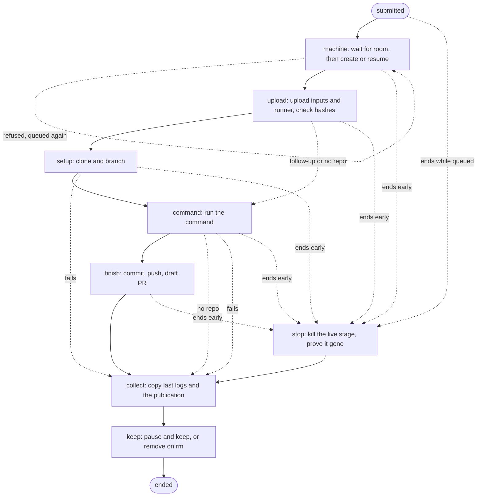
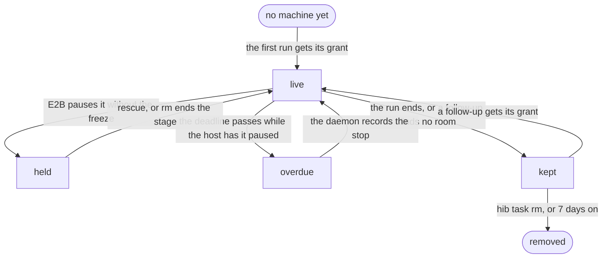
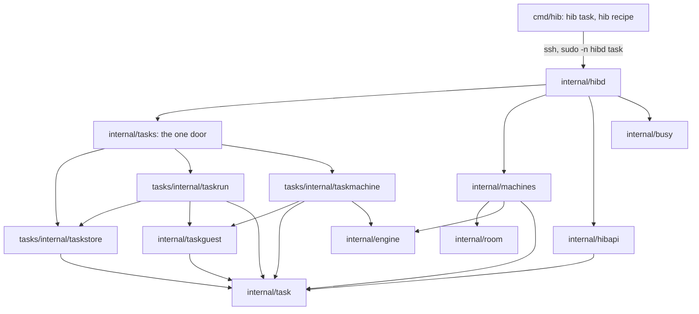
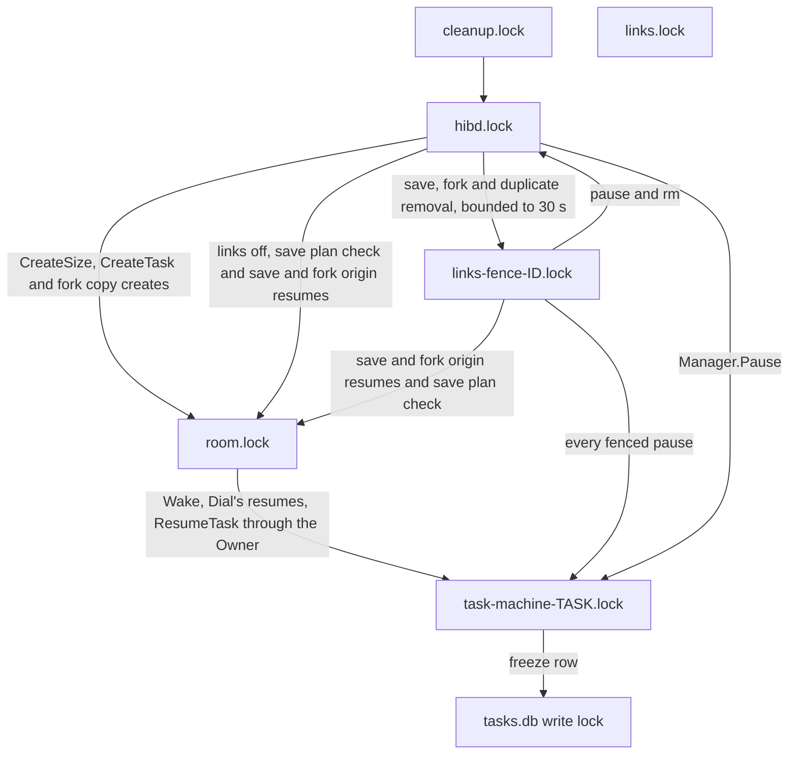

# Sketch: tasks as durable per-run workflows

This candidate types the task subsystem (M13 to M16) around one idea. Each run is one
straight-line Go function, and every step in it is a durable checkpoint in tasks.db. There is no
Decide table. The step enum is the state machine and the order of the calls is the transition
graph. A restarted daemon re-enters each run at its last checkpoint, and every step looks before
it acts.

This is the synthesis of two candidates: this workflow, behind the other candidate's seam. All of
it sits behind one package, `internal/tasks`, and the store, executor and owner are internal to
it. See Synthesis decision.

## Problem

`hib task start` hands the host a command, a prompt and some files. The host must find room,
make a machine, upload the inputs, clone and branch, run the agent, commit and open a draft PR,
then keep the machine paused for follow-ups and `ssh TASK.hib`. That work outlives every process
that touches it. `hib` calls are short SSH processes. One-shot `hibd` commands run as root or as
the login user. The daemon restarts whenever systemd says so, and shutdown pauses every machine
under it.

The outside world is hostile to a naive state machine:

- E2B is the only machine catalog, and Create is not idempotent.
- Exec replies get lost after the command ran, output over 8 MiB comes back empty, stdin stays
  open, a deadline can kill the command and a pause can land mid-call.
- Pauses come from many places in hibd, none of which knows about tasks, and from two places
  outside it, E2B's timeout and an orchestrator stop.
- Room is checked in several processes and reserved by none. The people reserve is private to
  the link path. Nothing counts vCPUs.
- tasks.db is opened by a root daemon, root one-shots, a root proxy and login-user one-shots in
  a state directory owned by the login user.

Binding decisions this sketch keeps: the CLI and transport in TASK.md, hibapi V1 plus
`FeatureTasks`, `requestId`, `errorCode` and `retryable`, the listed phases and outcomes, freeze
before every pause, the deadline wake guard, the people reserve, the limits and the 7-day keep.
No FSM library and no workflow engine.

## Usage (caller's view)

Written first. The types in Shape are derived from it.

### What a user reads

```text
$ hib task start --repo acme/api --prompt-file fix.md --recipe codex
t-k3x9q2ab  queued

$ hib task ls
TASK        RUN  PHASE    STAGE    REPO      AGE
t-k3x9q2ab  1    running  command  acme/api  4m

$ hib task logs t-k3x9q2ab -f          # copied output, from a byte cursor
$ hib task show t-k3x9q2ab             # runs, stage, deadline, holds, requests, PR
$ hib task wait t-k3x9q2ab             # returns when the run ends, prints its outcome
succeeded  https://github.com/acme/api/pull/412

$ hib task run t-k3x9q2ab --prompt "also fix the flaky test" --recipe codex
$ ssh t-k3x9q2ab.hib                   # the kept machine, woken like any other
$ hib task cancel t-k3x9q2ab           # recorded at once, carried out by the daemon
$ hib task rescue t-k3x9q2ab           # consent to wake a held machine and kill its stage
$ hib task rm t-k3x9q2ab               # stop, then remove the machine and the task
```

Every listing takes `--json`. A run shows exactly one of a phase (`queued`, `preparing`,
`running`, `paused`, `recovering`, `stopping`, `collecting`) and an outcome (`succeeded`,
`no_changes`, `failed`, `cancelled`, `timed_out`, `expired`, `lost`), plus the stage it is in or
failed in.

### Call site 1: a one-shot records, and nothing else

`hib task start` sends one JSON line, then the file bytes, to `sudo -n hibd task start`. The
handler parses at the boundary and saves. It never touches a machine.

```go
// internal/hibd/task.go
var req hibapi.TaskStart
json.Unmarshal(in.line(), &req)
sub, err := submissionOf(req, task.Actor{Owner: user, Name: user, Source: "cli"}, a.now())
cfg, err := loadSettings(a.Getenv)
st := a.tasks(cfg)
defer st.Close()
receipt, err := st.Submit(ctx, sub, in.rest())
t, err := st.Task(ctx, receipt.Run.Task)
instance, err := st.Instance(ctx)
run := t.Runs[receipt.Run.N-1]
reply := hibapi.Task{ID: t.ID, Repo: run.Spec.Repo.String(), Created: t.Created,
	Runs: []hibapi.TaskRun{hibapi.RunOf(run, instance)}}
a.reply(hibapi.Response{TaskReply: hibapi.TaskReply{
	RequestID: receipt.RequestID, Task: &reply}})
```

`hibd task cancel`, `rescue` and `rm` are the same shape with `Tasks.Request`. They write a row
and return. The daemon notices on its next tick.

### Call site 2: the daemon drives

```go
// internal/hibd/taskdaemon.go. e is engine()'s guarded engine.
m := machines.New(machines.Config{
	Engine: e, StateDir: cfg.stateDir, AuthorizedKeys: cfg.authorizedKeys,
	Now: a.now, ReadRoom: a.ReadRoom, Awake: a.awake,
	TaskLimits: machines.TaskLimits{HostCPUs: runtime.NumCPU()},
	Durable: func(ctx context.Context, id string) error {
		return a.durableSnapshot(ctx, cfg, id)
	},
	Fenced: a.snapshotFence(cfg),
})
d, err := ts.Daemon(ctx, tasks.DaemonConfig{
	Engine: e, Machines: taskMachines{a, cfg, e, m}, Logf: logf,
	Clock: taskDaemonClock{a.now}, Poll: a.taskPoll,
})
```

`startTasks` owns `d` in a serial worker. It retries startup every `tasks.Poll` until it holds
`tasks-daemon.lock`. It calls `d.Tick(ctx)` only while `a.awake()` succeeds, with no lock or
fence held. Busy and cleanup use the same engine and continue while a task tick blocks.
After cancellation, the worker calls `d.Close()` before the daemon logs `stopping`.
Setup stays empty in M13b. Task machines get no secrets, git identity or Codex login yet.

### Call site 2b: every engine is guarded

```go
// internal/hibd/hibd.go, engine(), which every hibd process uses
return a.tasks(cfg).Guard(e, "hibd"), nil
```

No hibd code can name the Owner, the store or the executor: they are under
`internal/tasks/internal/`. The daemon refuses an engine that didn't come from `Guard`.

### Call site 3: the workflow is the spec

```go
// internal/tasks/internal/taskrun/run.go
func (x *executor) Run(ctx context.Context) error {
	if err := x.refresh(ctx); err != nil {
		return err
	}
	if x.r.Ended() {
		return nil
	}
	var stop *task.StopIntent
	if err := x.main(ctx); err != nil && !errors.As(err, &stop) {
		return err // quit and re-enter later: every step is safe to run again
	}
	if err := x.stop(ctx); err != nil {
		return err
	}
	if err := x.collect(ctx); err != nil {
		return err
	}
	return x.keep(ctx)
}

func (x *executor) main(ctx context.Context) error {
	if s, ok := x.r.Stop(); ok {
		return s
	}
	if last, ok := x.r.Last(); ok && last.Step().WrapUp() {
		return nil
	}
	if err := x.machine(ctx); err != nil {
		return err
	}
	if err := x.upload(ctx); err != nil {
		return err
	}
	for _, s := range task.Stages() { // setup, command, finish
		ok, err := x.stage(ctx, s)
		if err != nil || !ok {
			return err
		}
	}
	return nil
}
```

### Call site 4: paths that change a machine ask first

```go
e := a.engine()          // taskmachine.Owner around the E2B engine, in every hibd process
err := e.Pause(ctx, id)  // a task machine's stage slice is frozen first, a person's is not
conn, err := e.DialWebSocket(ctx, id, 22, idle) // refused unless the access allows a wake

// hibd pause and rm, the leak scan's pause and the setup push ask before they act
if err := a.tasks(cfg).Check(ctx, em, task.OpPause); err != nil {
	return err // refused to pause task machine t-k3x9q2ab: the task has a run that hasn't ended
}
```

Callers keep calling the engine by sandbox ID, and the Owner guards every wake and copy under
them. The paths a person starts also ask `Tasks.Check` for their op, since only they may be
refused. See Task machine access.

## Shape

### Data first: one log per run, and rows other actors own

The heart is an append-only log of checkpoints per run. A checkpoint's body is a sealed sum type
with exactly one intent and one result per step, plus an exit for stages, so a body can't be
filed under the wrong step.

```go
// internal/task/steps.go
type Checkpoint struct {
	Run  RunID     // t-k3x9q2ab/1
	Seq  int       // 1, 2, 3 with no gaps: the store accepts only the next one
	At   time.Time
	By   Instance  // the daemon start that wrote it
	Body Body      // MachineIntent, MachineResult, UploadIntent, StageLaunched, StopIntent ...
}

type Body interface{ checkpoint() (Step, Kind) } // sealed: Kind is intent, result or exit

// internal/task/run.go
type Run struct {
	ID        RunID
	Spec      Spec         // immutable once submitted
	Actor     Actor        // who asked, the M17 seam
	Submitted time.Time
	Kept      string       // the sandbox the previous run kept, for a follow-up
	Log       []Checkpoint // the executor's and the grant's
	Requests  []Request    // the one-shots'
	Freeze    Freeze       // the latest freeze row, the Owner's
	Machine   MachineState // filled from E2B by the reader, never stored
}
```

No two actors write the same row. Each actor has its own rows and `Store.Run` merges them at the
read boundary:

| Record | Writer | Conflict rule |
| --- | --- | --- |
| checkpoints | the run's executor and the Supervisor's grant | `Seq` is a compare and swap |
| requests | `hibd task cancel`, `rescue` and `rm` one-shots | append only, unique request ID |
| freezes | the Owner, in any hibd process | append only, the latest wins |
| tasks, runs, inputs, receipts | `hibd task start` | one transaction, unique request ID |
| machine state | E2B | never stored, read on refresh |

The dominant access patterns, traced through that structure:

1. **Executor re-entry.** `Store.Run(id)` reads one run's log of at most about 20 rows, its
   requests and its latest freeze row. `last(step)` scans back from the end. One `Engine.Get`
   fills `Machine`.
2. **Daemon tick.** `Store.Unfinished` returns every run whose keep step hasn't closed: at most
   32 queued plus the live ones. `granted`, `Pick` and the nudge check scan that slice.
3. **`hib task ls`.** `Store.Tasks` plus one engine `List` by the `hib.task` label. Status is
   derived per run.
4. **A pause, wake or check anywhere.** The Owner's `Engine.Get` reads the label, and
   `Tasks.Check` reads it from the machine its caller looked up. Only a task machine costs a
   `Store.Task` read.
5. **Logs.** The host file's length is the cursor for copying and for `hib task logs -f`.
6. **Removal.** `Store.Removing` finds tasks with an rm request or an open removal, oldest
   first. It builds merged views only for those tasks, not other tasks' runs or checkpoints.
   The tick never scans `Store.Tasks`. Age-based retention waits for M16.

The primary keys and two indexes (`requests_task`, `inputs_hash`) serve the record reads.
Removal discovery may scan tasks and requests, but never another task's runs or checkpoints.

### The step table is the state machine

`internal/task/steps.go` has one table. Its order is the order a run enters steps, and nothing
else lists them. Each row names the step, the phase users see, the stage it runs, its skip rule
and its intent and result bodies.

| Step | Phase | Intent records | Looks before acting | Result records |
| --- | --- | --- | --- | --- |
| machine | preparing | the grant | Find the run's machine | sandbox ID, or refused |
| upload | preparing | upload began | nothing, Upload overwrites | hashes verified |
| setup | running | stage began | `runner look` | launched, then exit |
| command | running | stage began | `runner look` | launched, then exit |
| finish | running | stage began | `runner look` | launched, then exit |
| stop | stopping | the cause | `runner look` | how the stage ended |
| collect | collecting | collect began | host log length | log bytes, publication |
| keep | collecting | keep began | E2B state | paused, removed or gone |

Phases and outcomes are derived, never stored (`Run.Status`, `Run.Outcome`):

- The phase is the last checkpoint's step's phase, or queued with no checkpoint or a refused
  machine result.
- A request with no stop recorded yet shows stopping.
- A live stage on a paused machine shows paused, with `Held` set when the latest freeze row
  isn't frozen.
- An open intent written by another daemon instance shows recovering.
- The outcome is the stop's outcome if one is recorded, else failed at the first failed stage,
  else succeeded or no_changes from the publication.

The diagram below is `task.Mermaid()`, generated from the table. `TestMermaidGolden` fails when
this file or `testdata/steps.mmd` differs from it. Solid edges are the main line. Dotted edges
are skips, failures and early ends.



`task.CheckNext(log, body)` is the transition check. The store runs it inside `Append`, so no
writer can record a step out of order, even one that skipped the executor.

### Task machine access: one table for every path

Nothing changes a machine a run holds except the run itself and the user's own task stop:
`hib task cancel`, `rescue` or `rm`. `task.AccessOf(run, now)` derives the machine's access from
the task's latest run and the clock, and nothing stores it. Each hibd path that touches a
machine names one op, and `Access.Allows(op)` is the one rulebook. The table is
`task.AccessTable()`:

| access | wake | pause | remove | copy | setup | renew |
|---|---|---|---|---|---|---|
| live | yes | no | no | no | no | no |
| held | no | no | no | no | no | no |
| overdue | no | no | no | no | no | no |
| kept | yes | yes | no | no | yes | yes |

- **live**: from the run's grant until it ends. It wakes, for the daemon and for ssh, and
  nothing else touches it.
- **held**: a live stage paused without the freeze. Only a rescue or rm moves it.
- **overdue**: a frozen stage paused past the deadline. It wakes once the daemon records the
  stop, at its next look.
- **kept**: the run ended, or a follow-up waits for its grant. The machine is the person's
  again, except that only `hib task rm` removes it and nothing copies it.

The diagram below is `task.AccessMermaid()`. `TestAccessTransitions` proves every edge with a
fixture run, and `TestAccessGolden` fails when this file, `testdata/access.mmd` or
`testdata/access.md` drifts from the code.



| Op | Asked by |
| --- | --- |
| wake | the Owner's `Resume` and `DialWebSocket`: ssh, links, repin and the daemon's resume |
| pause | `hibd pause` and the leak scan's pause |
| remove | `hibd rm` |
| copy | `Fork` and `SaveImage` by label, and `Owner.SaveTemplate` as the backstop |
| setup | the setup push, which skips the machine until its run ends |
| renew | busy, through `Tasks.Exempt` |

- **Refusals say why.** Remove and copy always fail, with `ErrTaskMachine` and `ErrNoCopy`.
  Otherwise held fails with `ErrHeld`, overdue with `ErrPastDeadline` and live with
  `ErrRunLive`. The user reads "refused to pause task machine t-k3x9q2ab: ...".
- **The daemon's own pauses never ask.** The keep step, pause-all at shutdown and `Wake`'s pause
  again go through `Owner.Pause`, which freezes and never refuses, since they must always land.
  The removal after `hib task rm` calls `Manager.RemoveID` with the run's recorded ID
  without asking.
- **A person's machine pays nothing.** `Tasks.Check` passes a machine without the `hib.task`
  label and never opens tasks.db for it. A task machine fails closed when tasks.db can't be
  read.
- **Copy needs only the label.** No access allows one, so `Fork` and `SaveImage` refuse right
  after the lookup, before any pause or snapshot, and leave nothing to clean up.
- **A paused live run resumes.** `hib pause` can't pause a live run's machine, so only the host
  pauses one. At the daemon's next look `DecidePaused` resumes a frozen machine to thaw it, or
  to kill its stage once a stop is recorded. An rm ends the stage without a resume, and a
  machine paused unfrozen stays held.

### Who executes, and why a goroutine per run

The daemon executes every workflow. A `hib` call is too short to own one. The Supervisor runs
one goroutine per unfinished run, started by `Tick`. The alternative, advancing each run one step
per tick, loses here for three reasons.

- **Manager's locks block.** `hibd.lock` is polled for as long as a save or fork holds it, the
  fence wait is bounded at 30 s and an E2B create takes seconds. In a per-tick loop the slowest
  run stalls every other run, unless a worker pool is added, which is goroutines again.
- **A straight-line function needs a stack.** The code order is the transition graph only if
  the function runs top to bottom. A tick that re-derives "where am I" from the log on every
  pass is a Decide table without its purity.
- **One action per run comes free.** One goroutine makes its calls in sequence, so a run has at
  most one outside action in flight by construction. The test harness's counting engine checks
  it.

The cost is a goroutine per queued run, at most 32, asleep on the clock.

### Re-entry, the grant and requests

`Run` returns nil only when the keep result is recorded. Any other return means "quit and
re-enter from the log". The Supervisor restarts the function after a poll, or at once after a
nudge.

- **The grant.** Admission order lives only in the log. The Supervisor's `Tick` asks `Pick` for
  the oldest queued run that fits and appends that run's `MachineIntent`. `granted(runs)` is
  true while some run's last checkpoint is a machine intent, so at most one grant is open at a
  time, across restarts. A refused create records `MachineResult{Refused}` and the run is queued
  again.
- **Two writers, one rule.** The executor and the grant both append to a run's log. `Append`
  takes `Seq` as a compare and swap. The loser gets `ErrStale`, rereads and re-enters. Nothing
  else happens.
- **Requests.** Cancel, rescue and rm are rows. `Tick` sees a run's request count grow and
  cancels the workflow's context with the cause `errNudged`. The workflow re-enters and its
  `boundary` check finds the request. `boundary` runs between steps and on every poll while a
  stage runs. It refreshes the run and asks the pure `task.StopFor(run, now)` whether a cancel,
  the deadline, the queue limit or a lost machine is due. If one is, it records the
  `StopIntent` and the main line ends.
- **Removal.** Every tick reads `Store.Removing`, even with a grant open or no fitting run.
  One goroutine per task records removal begun, removes the last run's machine and records
  done. It retries open removals after a failure or restart, without blocking grants or nudges.
  No store or machine call holds the Supervisor's mutex. An rm refuses follow-ups immediately.
  The store rejects a stale removal decision while a run is live.
- **Repeated failures.** Each workflow, removal and task tick logs at most once per 10 minutes,
  with the latest text and a count of suppressed failures. Success does not reset the interval.
  Nothing logs after the daemon's life ends. `ErrNotRunning` stays silent. A workflow's state
  leaves when it returns; a removal's when done or declined; a task tick's when its loop ends.
- **The deadline.** It is the grant's time plus `Spec.Timeout`, so time in the queue doesn't
  count and paused time does. `RuntimeMaxSec` on each stage unit backs it up inside the machine.
- **The wrap-up.** Stop, collect and keep run after the main line ends, early or not. A request
  can't cut them short, only nudge them to re-enter.

### Module map



| Package | | Single job |
| --- | --- | --- |
| `internal/task` | new | The run's domain: step table, bodies, pure rules, status and access |
| `internal/tasks` | new | The one door: records, `Guard`, `Check`, `Exempt` and the one daemon |
| `tasks/internal/taskstore` | new | tasks.db, blobs and log copies, in short transactions only |
| `tasks/internal/taskrun` | new | The daemon's executor: one workflow per run, and the Supervisor |
| `tasks/internal/taskmachine` | new | The task machine's owner: freeze, wake guard, timeout floor |
| `internal/taskguest` | new | `runner.sh` and every argv hibd runs inside a task machine |
| `internal/taskguest/guestsim` | new | A fake engine that speaks the stage protocol, for tests |
| `internal/machines` | changed | `Admit`, `RoomLock`, task create, find and resume, no task copy |
| `internal/engine` | changed | `Machine.CPUs` and `Upload` |
| `internal/room` | changed | `Host.Reserve`, the people reserve as plain room arithmetic |
| `internal/busy` | changed | `Config.Exempt`, so a machine its run holds is left alone |
| `internal/hibapi` | changed | Task wire types, error codes, `FeatureTasks` |
| `internal/hibd` | changed | The task command table, `Guard`, the access checks and daemon wiring |

Interface depth. `internal/tasks` is the subsystem's whole surface to the rest of the repo: the
one-shot records (`Submit`, `Receipt`, `Request`, `Task`, `List`, `Logs`), `Guard`, `Check`,
`Exempt` and `Daemon` with `Tick` and `Close`. It hides admission order, re-entry, crash
recovery, log copying, stopping, freezing, the wake guard and the access table. The store's
writes (`Append`, `RecordFreeze`, `Retire`, `StartDaemon`) are reachable only inside
`internal/tasks`, so the compiler refuses a checkpoint, freeze row or removal written from hibd.
`Guard` hides four guards behind the engine interface every caller already uses.
`taskstore.Store` is wide because the records are, but it takes no callbacks, so no transaction
can span an outside call. Transport types stay in `hibapi`, and `submissionOf` parses them into
`task.Submission` at the boundary (per boundary-discipline).

## The ten questions

### 1. Who owns a task machine's lifecycle

**`taskmachine.Owner`**, a decorator of `engine.Engine` that `tasks.Guard` builds and `App.engine()`
returns in every hibd process: daemon, proxy, bridge and one-shots. Every pause and wake hibd makes
already goes through that engine, so the hook sits under all of them rather than beside each one.

```go
func New(e engine.Engine, s Store, l Locks, now func() time.Time, by string) *Owner
func (o *Owner) Pause(ctx context.Context, id string) error
func (o *Owner) Resume(ctx context.Context, id string,
	timeout time.Duration) (engine.Machine, error)
func (o *Owner) DialWebSocket(ctx context.Context, id string, port int,
	timeout time.Duration) (net.Conn, error)
func (o *Owner) SetTimeout(ctx context.Context, id string, timeout time.Duration) error
func (o *Owner) SaveTemplate(ctx context.Context, id, alias string) (engine.TemplateInfo, error)
func (o *Owner) Thaw(ctx context.Context, tid task.ID, id string) error
```

The wrapped engine is embedded under an unexported name, so nothing can reach around the guards
through a field.

**Freeze before pause.** `Owner.Pause` reads the label. For a task machine it takes
`task-machine-TASK.lock` and reads the machine again, since another process may have paused it
meanwhile. If it is still running it writes 1 to the slice's `cgroup.freeze`, waits for `frozen 1`
in `cgroup.events` and records whether the freeze held, then pauses. A failed freeze still pauses.
The row says unfrozen, so the run is held until a rescue, which is TASK.md's hung guest case.
A lost row reads as the row before it, which never says frozen while the stage runs, so it too
fails toward held. It covers:

- `pauseOrRemove`, through `Manager.Pause` (`machines.go:356`), once `Tasks.Check` allows it
- `pauseMachine`, so pause-all with links on and the leak scan (`hibd.go:506`)
- pause-all with links off, whose raw `e.Pause` is the same wrapped engine
- `Wake.pauseAgain` (`wake.go:108`)

Save and fork never pause a task machine: they refuse it first.

**The wake guard.** `Owner.Resume` and `Owner.DialWebSocket` take the machine's lock, read it again
and ask `task.AccessOf(run, now).Allows(task.OpWake)` for a paused task machine. A live or kept
machine wakes. A held one waits for a rescue, and an overdue one for the daemon to record the
stop. Covered paths:

- ssh `Dial` (`machines.go:420`) and repin (`machines.go:549`)
- link `Wake` in the proxy (`wake.go:48`)
- the daemon's own `ResumeTask`

A wake never thaws. Before a launch or while a stage runs, only the executor thaws, through
`Owner.Thaw`, which records unfrozen first. Under the lock `Thaw` checks again that no stop is
recorded or due and refuses with `ErrStopping` otherwise. A deadline that passes between the
executor's look and the thaw never lets the stage run. The one exception is `runner kill`, after
a recorded stop. It sends SIGKILL before thawing so `ExecStopPost` can write the exit record,
without letting the stage act. Its `StopResult` clears the live stage, so `AccessOf` and
`DecidePaused` never act on the stale frozen row.

**Pauses hibd doesn't make.** E2B's timeout and an orchestrator stop run no hibd code, so they
write no freeze row. The latest row then says unfrozen and the run is held: `task show` says
so, the held access refuses every op and only `hib task rescue` (wake and kill at once) or `rm`
moves it. The timeout floor in question 6 keeps E2B's timeout past the run's deadline, so the
first case needs the daemon to be down past the deadline plus margin.

**Fork and image save.** A task's machine is never copied, whatever its run is doing. Copying
out of a task makes no sense, live or ended, while copying into one (`hib task start --image`)
does. `Fork` and `SaveImage` refuse it by label with `task.ErrNoCopy` right after the lookup, so
nothing is paused, snapshotted or left to clean up, and the copy path needs no scrub of task
state. `Owner.SaveTemplate` refuses it too, as the backstop for any other path to the engine.
`hib task run TASK` works in the machine again.

**Pause and removal.** The daemon's `taskMachines` adapter keeps through `pauseMachine`
and removes the run's recorded ID through `pauseFenced` and `Manager.RemoveID`. The fence,
link closing and link-entry drop use the same helpers as `hibd pause` and `hibd rm`.
`FindTask` removes crash duplicates through their fences and checks again after removal.
A machine that appears without a recorded ID makes removal fail so the daemon retries.

`TestEveryMethodIsClassified` parses `owner.go` and fails when `engine.Engine` gains a method
that isn't listed as guarded or passing through. `SaveTemplate` is now guarded.

### 2. Sharing tasks.db across processes

- **Owner and mode.** tasks.db belongs to the state directory's owner, the login user, mode
  0600. `taskstore.Open` creates it if missing with `O_CREAT|O_EXCL|O_NOFOLLOW` and fchowns it,
  before SQLite sees the path, and never publishes by rename. -wal and -shm need nothing of
  ours: upstream SQLite opens every file with `O_NOFOLLOW`, and as root it chowns -wal, the
  journal and -shm to the database file's owner (`robustFchown` in `os_unix.c`). The modernc
  spike proves the transpiled driver keeps both, and Open checks the owners after its first
  transaction so a regression fails loudly.
- **Symlinks.** Open refuses a tasks.db that is a symlink, not regular or someone else's.
  `statefile` already opens its locks this way, through `os.Root` with `O_NOFOLLOW`. Hard links
  are refused by `fs.protected_hardlinks`.
- **PrivateTmp.** Every connection sets `temp_store(MEMORY)`, so no temp file needs `/tmp`.
- **Busy timeout.** `busy_timeout(2000)` with `_txlock=immediate`, so a write transaction takes
  the lock at BEGIN and never upgrades. A timeout becomes `ErrBusy`, then `BUSY` with
  `retryable`. The laptop retries with the same request ID.
- **Durability.** WAL with `synchronous(FULL)`. Input bytes are staged, hashed, synced and
  published as blobs before the rows that name them commit.

Lock order, outermost first. The SQLite write lock is always innermost and is never held while
waiting on anything else.



`links.lock` stays a leaf beside them: nothing that holds it takes a task lock.
`tasks-daemon.lock` is held for the task daemon's life and only ever tried, never waited for, so
it can't take part in a deadlock. It makes one hibd daemon the only executor. No transaction
spans a machine, E2B or lock call. `taskstore` methods take no callbacks, and `deps_test.go`
fails if the package imports engine, machines or anything that could make an outside call.

### 3. Create is not idempotent

The intent comes first. The grant records `MachineIntent` before E2B is asked. The planned name
is the task ID and the labels are a pure function of the run, so the intent row alone tells a
restarted daemon what to look for. `makeMachine` checks `boundary`, then looks before it acts:

```go
m, found, err := x.cfg.Machines.Find(ctx, x.r) // the recorded ID, else name and hib.task label
switch {
case found && m.State == engine.Running: // adopt what a crashed daemon created
case found:                              // resume through Machines.Resume and Owner's guard
case x.r.Kept != "":                     // the kept machine is gone: lost
default:                                 // create, under hibd.lock and room.lock
}
```

A crash between E2B's create and the result leaves the intent last. The next pass finds the
machine by name and records `MachineResult{ID, Adopted: true}`. The result records only the
sandbox ID as a reference. E2B stays the catalog. A create still in flight at E2B when the
daemon died is the remaining hole. The fix, still TODO: an intent another instance left open
waits out E2B's create timeout before it looks, so the in-flight create has landed or failed.
`Run.MachineID()` identifies the machine from the run's result, else the previous run's `Kept`.
`Find` reads it with `Engine.Get`, like `refresh`. A missing recorded machine returns not found,
never a duplicate. With no record, it keeps the earliest `StartedAt`, then ID. That is discovery,
not age. `StartedAt` moves on every resume. `Find` removes every unused named and labelled machine
by ID through its fence. A machine with the task's name but not its label fails with `ErrNotTask`.
`keep` passes the refreshed run through Pause or Remove. Pause acts on the machine `Find` keeps.
Remove kills that ID under its `rm` fence, never through a second name lookup, and drops its pin.
It then runs `Find` again with that ID recorded, removing late unused duplicates through their
own fences. Success means the recorded machine and every listed task-named, labelled machine
are gone. A new machine found without a recorded ID makes removal fail so a retry can remove it.

### 4. Exec hazards

Every argv the host runs in a task machine is built in `taskguest`, and the protocol is files
under `/var/lib/hib-task/RUN`.

- **stdin is open.** Nothing hibd runs reads stdin. `systemd-run --no-block` returns once the
  job is queued. The unit's own `StandardInput` is the prompt file or `null`, so the prompt is
  never in argv or on Exec's stdin.
- **Output over 8 MiB.** `runner look` prints a few lines. `runner log` prints at most
  `MaxLogChunk`, 1 MiB, from a byte offset. Collect stops at `MaxLogBytes`, 50 MiB, per run, summed
  over the stages in order. The executor's copy loop and `FileLogs.Append` both enforce the sum.
  An exited stage's host copy is final. Collect copies only launched stages without a `StageExit`.
  It counts kept bytes and reports all uncopied guest bytes as `Dropped` while the machine runs.
  `Dropped` can understate when the machine is not running at collect.
- **Lost replies.** Launch is idempotent by unit name and by a start marker made with `mkdir`.
  A second start exits 75 without acting. The executor launches only when a look says
  `NotStarted`, ignores `ErrConnectionLost` and judges the launch by the next look, never the
  reply. The exit record is written once by `ExecStopPost`, only by the invocation that made the
  marker. Uploads are judged by `runner verify` against the hashes. Log chunks are judged by the
  host file's length, the only cursor, so a lost chunk is read again and never appended twice.
- **Deadlines may kill.** Every Exec is short and bounded by `ExecTimeout`, 10 s. Long work runs
  in systemd units, which an Exec's death can't touch. A killed `systemd-run` either queued the
  unit or didn't, and the look tells which.
- **Exec races a pause.** `ErrNotRunning` and `ErrConnectionLost` mean look again after a poll.
  Exec never wakes, and `collect` never resumes a paused or gone machine.
- **Main-line readiness.** Every pass through `upload`, a stage launch or `await` checks
  `boundary`. A paused machine with a live stage goes through `DecidePaused`. With no live
  stage, `Machines.Resume` and Owner's guard apply `AccessOf`, which permits the daemon's wake.
  A recorded freeze goes through `Owner.Thaw` before exec. A held machine or a full room waits
  a poll without an error log. A successful resume and thaw continue in the same pass.
  `upload` checks even with its intent already recorded. The main line returns after the last
  stage, without another boundary that could turn its durable exit into an early stop.
  Wrap-up cannot be interrupted.

`runner look` reports the marker, the exit record, the log size, the unit's `systemctl show`
properties and the `frozen` line of its `cgroup.events`. `taskguest.Seen.Verdict()` turns that into
`NotStarted`, `Running`, `Exited` or `Vanished`.

### 5. Admission atomicity

`machines.Admit(h, running, lim, name, memoryMB, cpus)` is pure:

- memory and disk: `h.Reserve(PeopleReserveMB()).Check(...)`, so a task leaves one default
  machine's RAM for a person
- vCPUs: the running machines' `CPUs` plus the task's, at most `HostCPUs` times two
- an optional `MaxTasks` cap on running task machines

`PeopleReserveMB` is the one definition of the reserve. `linkRoom` moves to
`room.Host.Reserve(machines.PeopleReserveMB())` too. `engine.Machine` gains `CPUs` from E2B's
`cpuCount`. `HostCPUs` is `runtime.NumCPU()` in hibd, which runs on the host, with a settings
override.

Atomicity comes from `machines.RoomLock` (`room.lock`), a short flock held from the room reading
through one placement attempt by `CreateSize`, `CreateTask`, `ResumeTask`, `Wake`, Dial's resumes,
save and fork's origin resumes, and each fork copy's create. The save's plan check also holds it.
A running-machine ssh dial uses `DialRunningWebSocket`, which never resumes. Its traffic token
survives bridge processes and host restarts in hibd's private state directory. A pause after
Dial's read fails that call without resuming, then requires admission before a resumable retry.
A missing token also requires admission. If the running dial fails and E2B still reports running,
the engine keeps the token and returns the dial error with `ErrNoTrafficToken`. Dial then
admits one resumable fallback, whose connect stores the current token. The check lets a machine
already running through even on a full host. The next running dial needs no admission. An ended
context or task guard error does not trigger that fallback. Running repin uses non-resuming Exec.
Successful running dials and repins take no room lock or room reading. A paused repin's Resume
and dial share one admitted attempt, and its initialization runs after releasing the lock.
Cleanup and the daemon's sweep prune cached traffic tokens of machines E2B has forgotten.
If a create races with pruning and loses its token, the next dial takes one admitted fallback
and stores a fresh token.
A one-shot `hibd new`, an ssh wake and the proxy's link wake cannot spend pages a task admission
just counted, or the reverse. The lock is separate from `hibd.lock` so `Wake` and `Dial` do not
wait behind a save.
No holder takes a fence. The proxy's `pendingWakes` stay as coalescing within the proxy. Admission
no longer depends on seeing them. `TaskFits` gives `Pick` its order from one reading, and
`CreateTask` decides.

`saveCopy` checks its extra copy's plan under `room.lock`, then calls `SaveTemplate` outside it.
Two gaps remain. An admission can consume the copy's room before E2B starts it, so E2B can refuse
the save. hibd reports the failure and attempts to restore the origin. While the origin waits
paused for its snapshot, another admission can take its room. Its resume then fails, nothing is
saved, and the origin stays paused at a safe snapshot. No reservation spans the call or a crash.
`Admit` charges a machine with unknown `CPUs` the default size's vCPUs.

### 6. The busy watcher

`busy.Config.Exempt` is `Tasks.Exempt`, which is `Check(ctx, m, task.OpRenew) != nil`: the
machine has the `hib.task` label and its run holds it, or tasks.db can't be read. A kept machine
is renewed like any other. An exempt machine is neither renewed nor recorded as active.

- **The timeout tracks the deadline.** `CreateTask` and `ResumeTask` set
  `task.MachineTimeout(run, now)`: the time to the deadline plus `TimeoutMargin`. The Owner's
  `SetTimeout` floors every other caller at the same value, so a closing ssh keepalive or
  `Wake.settle` can't shorten it. Busy never renews it, and `Renew` never shortens.
- **No linked machines held awake.** Busy records activity for the machines it renews, and link
  authority follows activity. An exempt task machine gets no activity from its busy agent, so
  its links can't keep targets awake.
- **Frozen processes.** pgrep sees a frozen `codex`. For a live run that doesn't matter, since
  the machine is exempt. After the run ends the stop step has killed the stage, so nothing
  frozen is left to see.

### 7. Hand-synced lists

| how.md section 3 place | This design |
| --- | --- |
| `case` in `App.Run` | one case for both groups, rows in `hibapi.TaskCommands()` |
| usage text | `taskUsage(group)` from the table, test checks every row |
| the `-json` line | names every JSON leaf from the shared rows |
| `usesE2B` | falls through to `taskUsesE2B`, from the table's `E2B` field |
| `FeatureTasks` | one constant |
| `version` features | includes `FeatureTasks` because `task start` saves and the daemon runs it |
| `Response` fields | one embedded `TaskReply`, `TestTaskRunWire` |
| `cmd/hib` command tree | shares paths and summaries, keeps its flags and explicit stubs |
| `needTasks` gate | one function modeled on `needPorts`, in the task call helper |
| `callOptions` replay | fresh readers over captured bytes, with the same request ID |
| `complete.go` | no task ID completion, the cache knows no tasks |
| README and help tests | stay loud |
| daemon init | `startTasks` worker ticks every `tasks.Poll` and closes before `stopping` |

`TestTaskCommandsDispatchAndUsage` checks every row dispatches, appears in its group's usage and
is named in hibd's usage. Within the subsystem every enum is defined once in `task`:

- **Steps** are the table. `Steps()` and `Stages()` derive from it. `Mermaid()` derives from it,
  and `TestMermaidGolden` fails the build when this file's diagram drifts.
- **Phases and outcomes** are constants with `Phases()` and `Outcomes()`. A test checks every
  step's phase is listed.
- **Request kinds** have `RequestKind.Valid`. The SQL schema holds no enum `CHECK`, so there is
  no second list to forget.
- **hibapi** uses task's types for its enums, and `TaskRun.Check` parses a reply against
  task's lists, so hib refuses a phase it doesn't know.
- **CLI help** for `hib task ls` and `show` prints `task.Phases()`, `task.Outcomes()` and each
  step's `Doc()`. The README test makes the README follow.

### 8. The three-file trace

From `hib task start` to a launched setup stage, three files past the CLI:

1. `internal/hibd/task.go`: `taskStart` parses and calls `Tasks.Submit`. `startTasks` starts
   `Tasks.Daemon`.
2. `internal/tasks/internal/taskrun/run.go`: `Tick`, `grant`, then `executor.Run`, `machine`,
   `upload`, `stage` and `launch`.
3. `internal/taskguest/guest.go`: `Launch` builds the `systemd-run` argv and `Look` judges it.

Types come from `internal/task`. The store's contract is `taskstore/store.go`, and the facade
that wires them is `internal/tasks/tasks.go`.

### 9. Testing

**Pure decisions** (`internal/task/task_test.go`), table tests with no clock or I/O:
`TestCheckNext`, `TestCheckNextSkips`, `TestStatus`, `TestStopFor`, `TestDecidePaused`,
`TestPick`, `TestRetire`, `TestStepOrderIsTheTable` and `TestMermaidGolden`. `machines.TestAdmit`
covers admission.

**Task machine access** (`internal/task/access_test.go`): `TestAccessOf`, `TestAllows` and
`TestAccessGolden`, plus `TestAccessTransitions`, which proves every edge with a fixture run and
gives every access an edge in and out. The hooks each have a test that fails without them:
`TestPauseAndRmAskTheTaskRules`, `TestLeakscanMachineRefusesATaskMachine` and
`TestSetupDeliverySkipsATaskMachine` in hibd, `TestNoCopyOfATaskMachine` in machines and
`TestExemptMachinesLeftAlone` in busy.

**The daemon's behavior** (`internal/tasks/internal/taskrun/run_test.go`) runs the real Supervisor
and executor on `guestsim`, a fake engine built on `engine/fake` that speaks the stage protocol,
with the `Memory` store, the real Owner, a fake `Machines` with room for four and one fake clock.
That clock's `Now` feeds the Supervisor, the executor, the Owner and `fake.WithClock`. In hibd,
`startTasks` passes `a.now` to `machines.Config.Now` and `busy.Config.Now` as well, so `App.Now` is
the one clock a hibd test sets. A counting engine fails any test in which a machine has two outside
calls in flight.

- `TestCrashAtEveryAction`: crash right after each outside action of a clean run in turn, the
  action done and its reply lost, 24 subtests. A new daemon must finish with one machine, each
  stage started once and the same outcome.
- `TestCrashAtEveryAppend`: crash at each checkpoint's commit in turn, 17 subtests.
- `TestLostReplies`: lose the first reply of every kind of exec, and expect one launch each.
- `TestCancel`, `TestDeadline`, `TestQueue`, `TestRestartResumesFrozen`,
  `TestStrayPauseResumes`, `TestHeldUntilRescue` and `TestRemoveWhileRunning`.

`internal/tasks/internal/taskmachine/owner_test.go` covers `TestPauseFreezesFirst`,
`TestPauseAllFreezes` (through the real `pauseall.Run`), `TestWakeGuard`,
`TestNoCopyOfATaskMachine`, `TestCheck`, `TestThawRefusesAStoppingRun` and `TestTimeoutFloor`.
`internal/tasks/tasks_test.go` covers `TestOneDaemon` and `TestDaemonNeedsGuard`.

**The store** has one contract, `storetest.Run`, run on `Memory` and on SQLite in a temp directory
(`TestMemoryContract`, `TestSQLiteContract`). `storetest.RunLogs` is the same for `MemoryLogs`
and `FileLogs`. `TestOpenRefusesSymlinks`, `TestSQLiteRefusesLinkedSidecars` and
`TestFileLogsRefuseSymlinks` check the files the store opens. `TestHostRootStoreStaysTheOwners`
writes as root on a Linux host and checks every file stays the owner's. `TestNoOutsideCalls`
checks the package's imports.

**The stage protocol** runs `runner.sh` itself under `sh` in a temp directory, with no E2B and
no systemd: `TestStageStartsOnce`, `TestExitRecordIsWrittenOnceByItsInvocation`,
`TestLogIsReadInBoundedRanges`, `TestVerifyChecksEveryUpload`,
`TestLaunchKeepsThePromptOutOfArgv` and `TestVerdict`. `guestsim` models what the protocol
promises, and these tests hold `runner.sh` to it.

### 10. Platform facts

| Fact | Where the design depends on it | Spike |
| --- | --- | --- |
| envd `POST /files` | `Engine.Upload`, the upload step | ran through 100 MiB, note 017 |
| systemd PID 1, cgroup v2 freezer | launch, look, freeze, thaw | ran in M13a, four changes |
| a frozen unit survives pause | `AccessOf`, `DecidePaused` | ran in M13a, holds |
| modernc keeps no-follow and chown | `taskstore.Open` | ran in M13a, holds |
| E2B settles an abandoned create | the duplicate sweep, question 3 | ran twice, note 018 |

1. **envd `POST /files`.** `Engine.Upload` wrote nested 50 MiB, small and 100 MiB files as root.
   The last size is `task.MaxInputBytes`. Both rounds matched every `sha256sum`; the second
   replaced all bytes and truncated the small file from 4096 to 7 bytes. envd made missing
   parents as root:root, mode 755, and files as root:root, mode 644. No tested size was refused.
   `runner verify` still checks partial or wrong writes. Run `20261029T171639Z-4fbfa1` keeps
   `011-upload-api-round1.note.txt`, `012-upload-check-round1.txt`, rounds 2 in 013 and 014,
   and `017-upload-result.note.txt`. Its `evidence/spike-main.go` reruns the API calls.
2. **systemd and the freezer.** The spike ran in a dev machine with systemd 255 and cgroup v2.
   The dev image has no D-Bus, so `systemctl freeze` and `thaw` fail with "Failed to connect to
   bus". `systemd-run` and `systemctl kill`, `stop` and `show` work as root over systemd's
   private socket. Writing 1 to the slice's `cgroup.freeze` froze a counter at once and held
   across `daemon-reload`, while systemd's `FreezerState` still said `running`. Four changes
   are done in M13b, with failing-first tests and a rerun of the real guest argv.
   - Done. `Freeze` and `Thaw` write the slice's `cgroup.freeze` and wait, bounded, for its
     `cgroup.events` to say `frozen 1` or `frozen 0`. The slice has no cgroup until a stage has
     run since boot, and then there is nothing to freeze. `look` reports the `frozen` line of the
     unit's `cgroup.events`, and `Seen.Frozen` reads it instead of `FreezerState`.
   - Done. `Launch` passes `--expand-environment=no`. Without it systemd rewrote `$$` and
     `${HIB_RUN}` in the task's command.
   - Done. `Kill` thaws after it kills a frozen stage. A kill alone left `ExecStopPost` frozen, the
     unit timed out 30 s later and no exit record was written. With the thaw the unit ended
     14 ms after the kill, and its exit record said `result=signal` and `status=KILL`.
   - Done. A stage launched into a frozen slice ran nothing until the thaw, while systemd called
     it active. `Launch` refuses a frozen or transitioning slice with the reserved `ExitFrozen`
     code, without thawing it. Before exec the executor asks `DecidePaused` only while a stage
     is live. With no live stage, it resumes through `Machines.Resume` and Owner's `AccessOf`
     guard. A recorded freeze thaws through `Owner.Thaw`. The refusal is the backstop for a
     freeze not yet recorded. On that code the executor calls `Owner.Thaw` and re-enters
     through the stop and deadline boundary. Only `Owner.Thaw` permits a pre-launch thaw,
     after its locked stop checks and unfrozen record.
3. **A frozen unit across a memory pause.** The spike froze the slice, then ran `hib pause` and
   an ssh wake 30 s later. The slice still said `frozen 1`. Its counter held while a control
   counter outside the slice ran on, and it resumed on thaw.
4. **modernc keeps SQLite's file safety.** The spike ran with modernc.org/sqlite v1.61.0. `Open`
   checks tasks.db, -wal and -shm itself before SQLite opens them and again after the schema.
   `TestHostRootStoreStaysTheOwners` passed as root on the Azure host. Every file and directory
   root made stayed the owner's, and a root-owned tasks.db and a linked -wal were refused.
5. **E2B and an abandoned create.** Two clients were killed with SIGKILL after writing the
   complete create request and before `Engine.Create` returned. Neither label appeared in
   3 s samples through 75 s. These immediate disconnects do not prove every kill timing.
   E2B `5cfcf328` sets a 70 s request deadline in `packages/api/main.go:63-67,163` through
   `packages/shared/pkg/middleware/timeout.go:52-58`. Keep question 3's conservative guard.
   Run `20261029T171639Z-4fbfa1` keeps `010-create-timeout.note.txt`, both trials in
   `015-abandoned-create-1.note.txt` and `016-abandoned-create-2.note.txt`, and the empty-label
   cleanup in `018-abandoned-create-result.note.txt`. The M16 timeout wait remains TODO.

## Synthesis decision

**Base: candidate B, the durable per-run workflow** (claude-opus-5.5). Candidate A
(gpt-6.1-sol) was a reconciler: a pure `Decide` rulebook over 27 events and 18 actions, with
Manager as the lifecycle owner through `Change` receipts.

**The judge picked A, 22 to 14 of 30. This overrides it.** The judge's points against B were
real, but each was packaging or a point fix, and all are fixed or listed below. Its points
against A change A's core stance:

- In A, ssh and links never resume a paused task machine. TASK.md says ssh wakes a kept
  machine like any other. Fixing it means A's wake path must learn the freeze and deadline
  rules, which is B's Owner.
- A's shutdown pause-all waits on daemon receipts and never freezes itself. With the daemon
  down at shutdown, task machines pause unfrozen. B's Owner freezes in whichever process
  pauses.
- A leaves an uncertain action outstanding until a rescue. B looks before it acts and adopts.
- B's Owner sits under every engine path by construction, the best agent-proofing of the two:
  a new hibd command that pauses or wakes can't skip it. A needs every route migrated to
  `Change`, which was still unwired.
- B's tests are stronger: crash at every action and every append, lost replies, and the stage
  protocol run under `sh`.

The judge shares A's model family, so self-preference is possible. Scored by hand against the
rubric, the two were close, about 18 for A and 19.5 for B.

**Grafted from A:**

1. **The seam.** One facade package, `internal/tasks`, with the store, executor and owner under
   `internal/tasks/internal/`. B exported its store to hibd, so any package could append a
   checkpoint or a freeze row. Now the compiler refuses that. `Guarded` replaces reaching into
   `Owner.Engine`, which is now unexported.
2. **One daemon.** `tasks-daemon.lock`, taken by `Tasks.Daemon`. B had no singleton, so two
   daemons could run every task twice.
3. **No copy of a task machine.** A refused a live run's copy in `Owner.SaveTemplate`. The access
   table widens that to every task machine, refused by label in `Fork` and `SaveImage`, with the
   Owner as the backstop. B copied and relied on the scrub.
4. **One command table** for hib and hibd in hibapi, adopted for M14.

**Judge findings fixed in code:**

- The Owner reads the machine again under its lock before it pauses, wakes or dials, and `Thaw`
  rechecks the stop under the lock.
- `CheckNext` enforces the whole table: after a closed step only the step the table enters next
  for this run, passing over only the steps the spec skips. A failed stage goes to the wrap-up.
  A refused machine takes only a new machine intent or a stop. B allowed any later step.
- `taskstore.Open` pre-creates only tasks.db and relies on SQLite for -wal and -shm.

**Judge findings left as fill-in obligations:**

- [x] The 50 MiB log cap counts per run in the executor's copy loop, not per stage. Input limits
  apply per task, summed over its runs.
- `CommitAuthor` and `PRAuthor` are separate.
- A follow-up inherits the task's repo and workdir and can't change them.
- A machine with unknown vCPUs is charged the default size's. Covered by the room unit.
- The duplicate create sweep in question 3.
- Fork copy creates hold `room.lock`; SaveTemplate checks its plan but does not block wakes.
- hibapi gets its own wire structs rather than exporting `task.Publication`.

**Rejected:**

- From A:
  - the `Decide` rulebook, more vocabulary than a straight line with one early exit needs
  - Manager as the lifecycle owner, and `hibd.lock` as the placement gate
  - a separate store worker, and 16 KiB log chunks
  - uncertain actions that wait forever, ssh unable to wake a task, and a shutdown that
    depends on the daemon
  - a launch identity gate, which the copy refusal and exec by sandbox ID already cover
- From B: copying a live task with only the scrub, the exported store, and a `CheckNext` that
  only checked direction.

## Tradeoffs accepted

- We accept one goroutine per unfinished run, at most 32 queued plus the live ones, in exchange
  for a workflow that reads top to bottom and has one outside action in flight by construction.
- We accept that a nudge cancels an in-flight call in exchange for a cancel taking effect within
  one call instead of one poll. Every step re-enters by looking first, so a cut launch or upload
  is judged and redone.
- We accept two writers of a run's log, the executor and the grant, in exchange for the queue
  living only in the log. The `Seq` compare and swap makes the loser re-read.
- We accept an extra `Engine.Get` on every `Pause`, `Resume`, `DialWebSocket`, `SetTimeout` and
  `SaveTemplate` in every hibd process, and a second one under the lock for a task machine, in
  exchange for one owner that no path can skip and no decision on a stale state.
- We accept that a task machine can never be saved or forked in exchange for no copy ever
  carrying a task's stage or files, and no scrub. `hib task run TASK` works in it again.
- We accept that `hib pause`, `hib rm`, the leak scan and the setup push refuse or skip a machine
  its run holds in exchange for nothing changing a run's machine but the run and the user's own
  task stop. Only `hib task rm` removes a task's machine, even a kept one.
- We accept that only the hibd daemon holding `tasks-daemon.lock` runs tasks in exchange for no
  run ever having two executors. A second daemon still does everything else.
- We accept one facade that re-exports four errors and two types in exchange for a store that
  only the executor and the Owner can write.
- We accept that the Owner and `Tasks.Check` fail closed in exchange for never waking a held
  stage. With tasks.db unreadable, nothing but the daemon's own pauses touches a task machine.
- We accept one `Engine.Get` per live run per poll in exchange for never storing machine state.
- We accept that a run held past its deadline shows stopping until rescue or rm in exchange for
  hibd never waking an unfrozen agent on its own.
- We accept that collect on a paused or gone machine records no publication, so the run reads as
  no_changes, in exchange for collect never waking a machine.
- We accept that `room.lock` makes a person's `hib new` wait for a task's create in exchange for
  admission that holds across processes.
- We accept a schema with no enum checks in exchange for `task` being the only list.

## Alternatives considered

**A Decide table, item 10 as proposed, and candidate A.** A pure `Decide(run, event)` returns
the next intent,
`Apply` saves it in one transaction with a revision check and the loop carries out one action
per run. Where it honestly wins:

- Every decision sits in one pure function, tested by table rows alone. Here they are spread
  through step code and tested through `guestsim` and a fake clock.
- Its Mermaid can be generated from the full rules, guards included. Here the diagram proves
  the shape only, and guards are tested apart.
- One writer per run and no nudge cancelling calls mid-flight.
- No goroutine per run.

Where it loses: a multi-call step such as launch (look, launch, look again) becomes several
states or hides inside an action, and a reader can't follow one run top to bottom. The decisions
that matter most stay pure here anyway: `StopFor`, `DecidePaused`, `AccessOf`, `Allows`, `Pick`,
`Retire`, `CheckNext`, `Admit`, `Status` and `Outcome`.

**One step per run per tick.** Lost because Manager's locks and E2B calls block, so one run
stalls the others without a worker pool, and because re-deriving the position on every tick is a
Decide table without the purity (see Who executes).

**An agent inside the machine that reports back.** Lost because it needs a guest daemon, a
channel and its auth, while systemd units and marker files give idempotent launches and durable
exits for free.

## Open questions and risks

- Should a run held past its deadline show `stopping` with `Held`, or a phase of its own?
- `systemd-run --no-block` can return 0 and the unit never start. How many looks that find it
  `NotStarted` should pass before the stage records `launch-failed` (TODO in `launch`)?
- Two immediate create-client deaths left no labeled machine through 75 s, as question 10
  records. Keep question 3's may-finish guard for other kill timings and the M16 timeout wait.
- Is one `Engine.Get` per live run every 5 s acceptable E2B API load at the `MaxTasks` cap?
- Should the 7-day keep count from the last run's keep, as `Retire` does, or from the last ssh?
- envd uploads passed through 100 MiB with parents and replacement. Both abandoned-create
  labels stayed empty beyond the 70 s request bound. Question 10 names their evidence.
- Should the dev image gain D-Bus, so systemd freezes the slice and reports it? That costs an
  image rebuild and a daemon in every machine. The cgroup writes in question 10 need neither.

## Next implementation step

M13a is done. The SQLite store and `FileLogs` pass their contracts without a tag, and the
freezer, pause and modernc spikes ran. Question 10's four guest changes are done in `taskguest`,
`runner.sh` and `guestsim`, each with a test that fails without it. The executor now spends one
50 MiB log budget per run in stage order and records dropped bytes. Each `FileLogs.Append`
syncs the file and five directories, so the loop batches a poll's chunks into one append,
buffering at most the remaining run budget plus bounded protocol chunks.
Both stores' `Submit` now refuse inputs past `MaxInputBytes`, summed over the task's runs.
Receipt replays precede the cap check. Refusals leave no rows or published blobs and remove
staged files. `task.ErrInputFull` maps to the non-retryable `hibapi.CodeInputFull`.
M13b still needs the engine and room changes.
